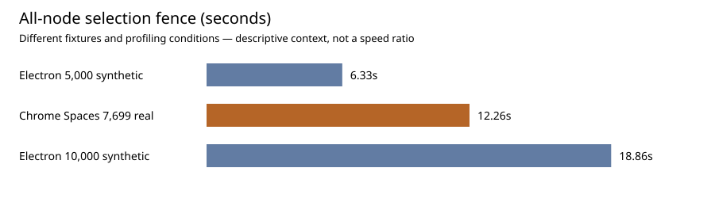

# Authenticated production performance follow-up

2026-11-08. Existing owner Chrome profile only, Chrome 156, visible window with docked DevTools. No repository edits, builds, commits, pushes or deployments. Read CLAUDE.md and both restored prior reports. The collaboration report is a reconstructed summary; the old Electron traces are unavailable.

**Selection remains a production bottleneck.** On Spaces, selecting all 7,699 active-page nodes took **12.26 s to a two-animation-frame fence**, including **1.90 s synchronous API work**, in the fully captured repeat. The longest renderer task in that recording was **11.19 s**. The trace also contains document cloning and storage-size traversal. This supports investigating selection/UI and document-wide work before replacing the renderer.

**This is a qualified follow-up, not a complete controlled benchmark.** AUDIT's state was unstable; heap profiling disrupted DevTools; physical Cmd+A did not produce a verified all-node result. Precise canvas-interactive times, room/asset response cache headers, and a Spaces WebSocket handshake/frame capture remain unavailable. See the coverage and exclusions below.

## Method and privacy

Used agent-desktop on the existing Chrome window and its DevTools Network, Performance, Memory and Console panels. Did not create a separate browser, copy credentials, export HAR, or close the owner's tabs. Console instrumentation collected Resource/Navigation/Paint Timing, long tasks, explicit operation marks, two-rAF fences, selected/node counts, and WebSocket message byte lengths. No message bodies, auth headers, cookies, account emails or document text were intentionally exported. Traces were saved with resource content excluded, then sanitized; screenshots retain only DevTools regions. Heap snapshots stayed inside DevTools; only sizes/counts were transcribed.

Network cache disabled/enabled states were explicitly verified. No network/CPU throttling was configured. The existing profile includes extensions: React DevTools' installHook.js appears materially in CPU samples. The narrow viewport with DevTools docked differs from earlier full-window Electron tests. Runs are single observations or two descriptive repeats, not field percentiles or an isolated-machine benchmark.

API selection includes every node on the page, including descendants; it is **not equivalent to scoped keyboard Cmd+A**. The fence is a zero-delay task plus two requestAnimationFrame callbacks, not proof of complete pixels or input-to-photon latency. Pan/zoom below are single API camera changes, not sustained physical gestures. Expensive selection work immediately precedes them, so background tasks can dominate their fences.

## Load results

Resource totals use requests **started in the first 10 seconds** after navigation/open where available, and include account-state traffic. Resource Timing omits some browser/extension activity and cross-origin sizes; it is not identical to the Network panel request count. Sizes are decimal bytes. Navigation document size is separate from resource totals.

| Case | TTFB, request→first byte | FCP | Requests/resources | Transfer | Decoded |
|---|---:|---:|---:|---:|---:|
| Files, cache disabled | 116.0 ms | 1,832 ms | 87 resources started in first 10 s | 3,450,240 B | 20,214,515 B |
| Files, warm cache | 75.6 ms | 892 ms | 84 captured resources | 1,697,079 B | 16,126,083 B |
| AUDIT initial open, cache disabled | room 1,331.4 ms | not a new navigation | 10 first-10-s resources | 2,250,660 B | 19,386,169 B |
| Spaces initial open, cache disabled | room 1,095.5 ms | not a new navigation | 32 captured resources | 3,655,708 B | 16,964,348 B |
| AUDIT warm open | room 985.4 ms | not a new navigation | 8 captured resources including five account-state calls | 2,832,166 B | see raw JSON |
| Spaces warm reopen | no new room fetch observed | not a new navigation | 7 captured account-state resources | 3,895,349 B | account-state traffic, not room download |

Files navigation DOMContentLoaded/load: cache-disabled **555/709.5 ms**, warm **164.4/273.1 ms**. Network panel separately showed **92 requests, 3.5 MB transferred, 20.3 MB resources**, DOMContentLoaded 543 ms/load 698 ms at its observation point; these rounded panel values and Resource Timing values are reported separately rather than silently reconciled.

Warm Files buffered LCP was **892 ms**. A later cache-disabled root navigation before opening Spaces recorded buffered LCP **1,280 ms**. Neither is an editor-open LCP. LCP for the original cache-disabled Files run was not retained; FCP is not substituted for it.

Spaces' populated page and controls were observed at **6,249 ms after open**, after a nominal five-second timer was delayed. Warm Spaces and AUDIT observations were **5,134/5,063 ms** after click. These are deliberately coarse observation upper bounds, **not measured time-to-interactive milestones**. AUDIT's initial click→socket-open was about **2,797 ms**; socket-open is also not canvas interactivity.

### Payloads, caching and duplication

- Initial AUDIT room snapshot: **22,417 B encoded / 3,048,940 B decoded**, total request duration 1,354.9 ms. Client showed only **3 nodes**.
- Warm AUDIT snapshot: **48,381 B encoded / 5,629,184 B decoded**, request duration 1,007.7 ms. Client still showed 3 nodes. Payload changed between runs, so this is not a matched-content cache speed comparison.
- Spaces room snapshot: **430,267 B encoded / 6,692,835 B decoded**, duration 1,281.6 ms. Initial client observation: pages **7,699 and 0 nodes**. A later warm observation showed **7,699 and 8,551**. The second-page difference could reflect loading or concurrent state; cause was not established. No edits were made to Spaces.
- Spaces initial capture included **26 room-asset resources**; later interaction capture included more. Sanitized asset IDs collapse to the same placeholder, so repeated placeholder paths must **not** be counted as duplicate identical assets.
- Both AUDIT and Spaces initial opens made **two /access requests**. This confirms two in these captures, not the earlier unconfirmed four.
- Files loaded **56 JS resources**, totaling **1,056,086 B encoded / 3,454,820 B decoded**, plus **12 CSS resources**, **65,511 / 337,097 B**. These are authenticated application totals, larger than the earlier login-only JS total.
- Largest observed JS: legacy-ui-CXHsJAu3.js **446,317 / 1,577,689 B**, index-Dpo3UJ4v.js **172,198 / 511,806 B**, canvas-interactions.js **45,666 / 159,516 B**.
- Supplementary HEAD requests in the same Chrome session verified **public, max-age=0, must-revalidate** and **zstd** for the hashed index bundle, app.js and style.css. This confirms the reconstructed caching finding for these resources. Room and asset response cache headers were not captured; do not extrapolate static-file policy to them.
- Repeated **/api/me/state** responses were about **556 KB encoded / 4.08 MB decoded**. Initial cache-disabled Files capture eventually contained nine calls. Later multi-minute captures contained dozens; total bytes from those longer windows must not be presented as startup bytes. This warrants checking whole-account/document serialization separately from room-operation payloads.

Initial AUDIT WebSocket constructor→open: **1,392 ms**. Captured application messages around connection were **78–189 bytes** in either direction, including 95-byte sends. During the later small drag/edit pass, outgoing messages ranged **139–847 bytes**; many were 180–182 bytes. These are UTF-8 application-message sizes, not compressed wire bytes or WebSocket framing overhead. Bodies were not retained, so presence versus edit classification and acknowledgement latency are unverified. No fresh large-edit payload or Spaces handshake result is claimed.

Evidence: files-cache-disabled.json, files-warm.json, audit-cache-disabled.json, audit-warm.json, spaces-cache-disabled.json, spaces-warm.json, cache-headers.json and load-summary.json.

## Spaces interactions — verified read-only sequence

Two production API passes, active page **7,699 nodes**. Both report identical serialized page contents before/after their sequence. No drag, property change, save action or document mutation was performed on Spaces.

| Operation | First pass sync / fence | Verified full-trace repeat sync / fence |
|---|---:|---:|
| Select 1,000 nodes | 1,128.9 / 2,712.4 ms | 915.0 / 1,933.0 ms |
| Select all 7,699 | 1,969.1 / 12,400.5 ms | 1,898.3 / 12,258.8 ms |
| Clear selection | 1,192.2 / 4,068.9 ms | 1,221.8 / 3,663.1 ms |
| Single pan update | 1.2 / 61.9 ms | 1.2 / 601.6 ms |
| Single zoom update | 1.1 / 524.5 ms | 1.4 / 62.5 ms |

Full recording: **spaces-verified.trace.json.gz**. All five operation start/end marks exist. Across the recording: **17 renderer-main RunTask events >50 ms**, longest **11,185.8 ms**, total **19,173.2 ms**. Clipped to all-selection marks: **five >50 ms task overlaps**, largest **11,127.3 ms**, total **12,278.6 ms**. Mark windows include count verification after the fence, so their duration slightly exceeds the displayed fence.

Trace contains **421 DroppedFrame events**, 1,142 BeginFrame events and six DrawFrame events. These are raw trace-event counts across the recording, not a validated percentage of unique missed display presents; event streams have different scopes. No FPS or input-to-photon number is inferred.

Top sampled self-time entries across the complete recording:

| Function / source | Sampled self time |
|---|---:|
| o / legacy-ui | 3,184 ms |
| anonymous / legacy-ui | 2,453 ms |
| garbage collector | 1,636 ms |
| a / legacy-ui | 1,319 ms |
| render / app.js | 1,258 ms |
| getDocument / app.js | 1,189 ms |
| measureHostInstance / React DevTools installHook.js | 787 ms |
| OO / legacy-ui | 579 ms |
| walk / storage-limits.js | 336 ms |
| get offsetWidth | 275 ms |
| getBoundingClientRect | 129 ms |
| sharedSize / storage-limits.js | 125 ms |

These are CPU sample attribution, not exclusive operation stopwatch timings. Minified names are unresolved. getDocument samples include the audit's own verification clones as well as app calls, so its entire total cannot be assigned to production subscriptions. Nested trace event totals overlap and must not be summed as percentages.

First post-selection performance.memory sample: **1,133,078,119 used bytes** (about 1.055 GiB). This is not RSS/GPU memory or a clean baseline. The first Spaces heap snapshot reached 100% but did not finish reliably; closing/reopening DevTools was followed by a changed renderer process. The attempted subsequent trace with no action markers was excluded. A second Spaces heap snapshot later stalled at 95% and was canceled by closing DevTools; no completed Spaces snapshot size is claimed.

Evidence: spaces-interactions.json, spaces-verified.json, spaces-verified.trace.json.gz, its summary JSON, and spaces-scoped-longtasks.json. spaces-selection.trace.json.gz is a **partial first-pass trace**, ending during all-selection; do not use it to attribute the entire 12.4 s operation.

## AUDIT: unstable large fixture; valid small-document evidence

The initial room client had 3 nodes although its HTTP snapshot was roughly 3 MB decoded. This is consistent with, but does not independently prove, the reconstructed report's revision-equality divergence.

Added 4,900 temporary rectangles to the authorized throwaway room, observing **4,903 nodes and 115,491 DOM elements**. Later the client had **904 nodes** without an intentional audit deletion of 3,999 nodes. Thus the synthetic large-fixture API timings and traces are **excluded as controlled 4,903-node comparisons**. Initial unprofiled all-selection API duration was 915.7 ms with subsequent long tasks, but contemporaneous count stability was not guaranteed. Do not quote it as a 5K benchmark.

Restored the captured three-node starting document and later verified the client again showed three nodes. Then measured successful opacity edits: **3.1 ms unprofiled**, **2.6 ms profiled**, each returning true. A physical 700-ms drag changed the target from **(1600,181.95) to (2033.5,367)**. Its trace includes production follow/selection-chrome functions. The complete small recording had one >50-ms task, **261.2 ms**, attributable to profiler startup; no >50-ms drag/edit task was established. One DroppedFrame event was present.

Physical Cmd+A was sent, but subsequent selected count was **1**, not all nodes; therefore keyboard Select All performance remains unverified. A fourth node appeared by final inspection. Its origin was not established. Preserved that unknown addition, restored only the audit target's original x/y/opacity, and verified restoration true. This avoids erasing potentially concurrent work.

The AUDIT Memory panel snapshot completed at **554 MB**, **6,818,970 objects** (object summary 549 MB), including **30,905 detached buttons**. It is the same long-lived tab after Spaces profiling, with retained document/DevTools/audit objects; this is not evidence that a fresh three-node room needs 554 MB. No raw heap snapshot was exported.

Evidence: audit-count.json, audit-large-count.json, audit-interactions.json, audit-selection.json and traces (unstable diagnostic runs); audit-valid-edit.json, audit-small.json, audit-small.trace.json.gz and summary (small run); cleanup.json and memory-summary.json.

## Comparison with the restored Electron report

| Conclusion | Production assessment |
|---|---|
| Selection/UI work is the first priority | **Confirmed qualitatively.** Local 5K median fence 6.33 s, 10K 18.86 s; real Spaces 7,699 active-page nodes ~12.26–12.40 s. Fixture, nesting, total document pages, viewport, runtime and profiling differ; this is not an interpolated regression score. |
| Whole-document clone/commit/save work merits investigation | **Corroborated, not fully re-benchmarked.** Full production trace contains render/getDocument/storage traversal and substantial GC; account-state downloads repeatedly carry ~4.08 MB decoded. Local 5K/10K edit medians were 217.5/436 ms. Current valid three-node edits cannot validate or refute those large-document numbers. Spaces was read-only. |
| Collaboration payloads/stalls are established | **Partially corroborated.** Large room/account snapshots, duplicate access requests and unstable AUDIT state are observed. Small outbound messages are modest. Did not reproduce the 4,900-node server crash, revision inconsistency, per-batch server rewrite, mid-drag remote-overwrite race, or sustained-edit debounce latency under controlled two-client conditions. |
| A GPU rewrite is the immediate fix | **Not supported.** Production evidence still points to selection/UI, document processing and sync/loading. Camera setters themselves were fast, while downstream work could stall the fence. |

The old local measurements were synthetic Electron runs, generally unprofiled for their timing table, using mixed nodes and full-window conditions. Fresh Chrome traces include extension/profiler overhead. Both support the same investigation priority; they do not establish a browser-versus-Electron speed ratio.

## Coverage, cleanup and remaining gaps

Completed: authenticated Files cache-disabled/warm navigation; AUDIT/Spaces open payloads; warm reopen observations; static cache headers; two access calls per initial join; AUDIT socket timing/sizes; full Spaces marked selection/pan/zoom trace; small AUDIT physical drag/property trace; heap observations; privacy-filtered artifacts and comparison.

Not completed to the requested precision: exact canvas-interactive milestones; initial cold Files LCP; fresh navigation FCP/LCP for SPA file opens; room/asset response cache headers; Spaces WebSocket timing/sizes; verified physical Cmd+A all-node selection; sustained gesture FPS/input latency; controlled 4,903-node edit/drag benchmark. Spaces drag/property edits were intentionally omitted to obey its read-only restriction. Failed/excluded captures are identified in excluded-runs.json.

No HAR was saved. Retained screenshots show only DevTools, without avatars/account UI. Temporary console instrumentation is removed by final root navigation; DevTools is closed. No browser tab was opened by this audit, so no owner tab was closed. Chrome remains running. No repository files were edited.

## Artifact links

- [Verified Spaces trace](astra-prod/spaces-verified.trace.json.gz) and [timings](astra-prod/spaces-verified.json)
- [Spaces scoped long tasks](astra-prod/spaces-scoped-longtasks.json) and [CPU/trace summary](astra-prod/spaces-verified.trace.json.summary.json)
- [AUDIT small-document trace](astra-prod/audit-small.trace.json.gz) and [edit/drag/message observations](astra-prod/audit-small.json)
- [Load summary](astra-prod/load-summary.json), [cache headers](astra-prod/cache-headers.json), [memory observations](astra-prod/memory-summary.json)
- [Excluded runs](astra-prod/excluded-runs.json), [edit restoration](astra-prod/cleanup.json), [browser cleanup](astra-prod/browser-cleanup.json), [privacy check](astra-prod/privacy-check.json)
